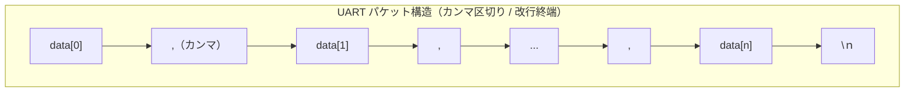
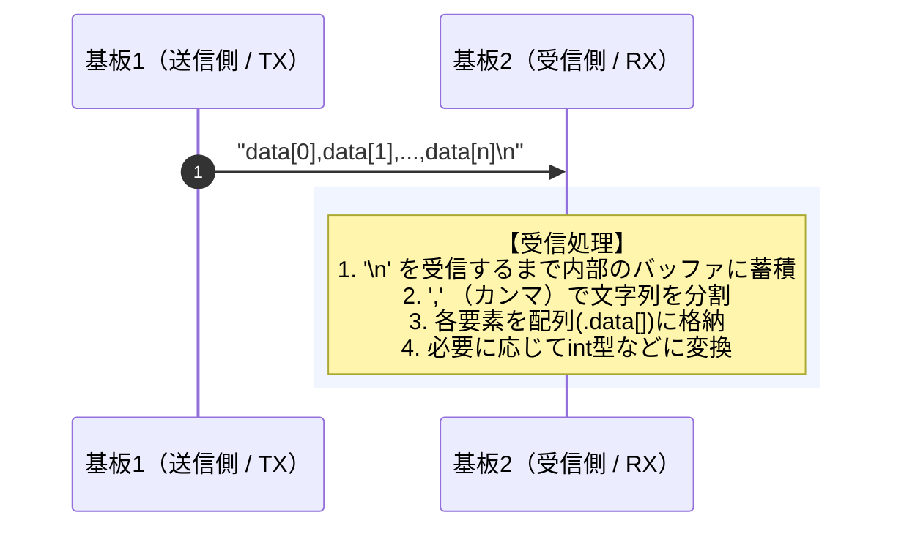

# 基板間のUART通信について
## 通信の基本
基板間のUART通信の基本的なフォーマットについて述べる．

### パケット構造
- 各データをカンマで区切り，終端に'\n' を付加して送信する．


### 送受信シーケンス（基板間の通信と処理の流れ）
- 送信後，`TORICA_UART.h/.cpp`が受信したデータを分解し，それぞれ配列に格納する．



# 実際のコード
Bico-Underのコードが一番簡素でわかりやすい。
## Bico-Under
### 送信コード(Under側)
[L30-L40](https://github.com/torica-org/2026-fm-archives/blob/main/Software/Underside/26th_Underside/UARTHelper_Under.cpp#L30-L40)
```c:UARTHelper_Under.cpp
void transmitLog () {
  memset(trans_buff, 0, sizeof(trans_buff)); // 配列を0で初期化
  sprintf(trans_buff, "%.2f,%.2f,%.2f,%.2f,%.2f\n", data_under_bmp_pressure_hPa, data_under_bmp_temperature_deg, data_under_bmp_altitude_m, data_under_urm_altitude_m, data_under_tsd20_altitude_m);
  Serial1.print(trans_buff);
（中略）
}
```
全体の流れは、まず送信するデータを格納するバッファ(このコードでは`trans_buff`)を用意し、そのバッファにデータを格納する。格納したら送信するという流れ。

まずは`memset()`でバッファ`trans_buff`内のデータを0で初期化。`sprintf()`で送信するデータをカンマ区切りで並べて整形。最後に`Serial1.print()`でエアデータBicoへ送信。

### 受信コード(Bico側)
`UARTHelper_Bico.h/.cpp`にUART通信の本体部分が，`26th_Air_Bico.ino`に通信を実際に実行するコードが書かれている．

[L280-L302](https://github.com/torica-org/2026-fm-archives/blob/main/Software/AirData/26th_Air_Bico/UARTHelper_Bico.cpp#L280-L302)
```c:UARTHelper_Bico.cpp
void receiveUnderLog() {
  // 機体下受信
  static unsigned long int last_under_time_ms = 0;
  int readnum_under = Under_UART.readUART();
  const int under_data_num = 5;  // 正常な場合のデータ受信数

  if (readnum_under == under_data_num) {
    last_under_time_ms = millis();
    // 受信データを格納
    data_under_bmp_pressure_hPa = Under_UART.UART_data[0];
    data_under_bmp_temperature_deg = Under_UART.UART_data[1];
    data_under_bmp_altitude_m = Under_UART.UART_data[2];
    data_under_urm_altitude_m = Under_UART.UART_data[3];
    data_under_tsd20_altitude_m = Under_UART.UART_data[4];
  }

  // 最終受信時間から1秒以上経過している場合は機体下が死んでいるとみなす
  if (millis() - last_under_time_ms > 1000) {
    under_is_alive = false;
  } else {
    under_is_alive = true;
  }
}
```
`last_under_time_ms`は最後に機体下からデータを受信した時刻を格納する変数、`readnum_under`は機体下から受信したデータの個数が格納される。

`if (readnum_under == under_data_num) {...}`内では、データ受信が成功した場合の処理が記述されている。まず時刻を記録、あとは受信したデータを順番に変数に格納、といった流れで行われる。


## Bico-Fuselage
該当部分：[L305-L348](https://github.com/torica-org/2026-fm-archives/blob/main/Software/AirData/26th_Air_Bico/UARTHelper_Bico.cpp#L305-L348)

やってることはBico-Underとまったく同じ。

## Bico-XIAO間
該当部分：[L363-L400](https://github.com/torica-org/2026-fm-archives/blob/main/Software/AirData/26th_Air_Bico/UARTHelper_Bico.cpp#L363-L400)
ほかのコードと違い、数値ではなく文字列を扱う。ESP32から文字列を受信したときこのコードが動く。
```c:UARTHelper_Bico.cpp
void handleEspSignal() {
  // エアデータ ESP32 XiaoからRESETやCALIBなどのシグナル受信
  if (ESP_UART.listenUART()){
    // 文字列のどこかに"RESET"が含まれている場合
    if (strstr(ESP_UART.buff, "RESET") != NULL){
      Serial_Under.print("\nRESET\n"); // UnderはUARTを受信するとそのままSD書き込み用バッファに送り込まれる
      Serial_fslg.print("RESET"); // 胴体桁基板は受信すると文字列解析にかけられる．
```
`.listenUART()`でUART受信を行うと、内部のバッファ`.buff`に受信データが保存される。

`strstr()`は文字列の中から文字列を検索し、一致が始まった文字列のポインタを返す関数である。例えば、`1.23\nRESET\n2.34...`のようなデータを受信したとする。これには`RESET`という文字列が含まれているため`RESET`という文字列が始まるメモリのポインタを返す。つまり、該当する文字列があればポインタを返し、なければ`NULL`を返す。

`if (strstr(ESP_UART.buff, "RESET") != NULL){`は`RESET`という文字列を探すコードである。

もし`RESET`という文字列があれば、機体下や胴体桁にも同じく`RESET`という文字列を送信する。機体下では受信データをそのままSDに書き込む仕様なので、ログデータのcsvファイルでは空白行の間に`RESET`という文字列が挿入されることになる。


## Bico-Rudder
ラダーの操舵角を得るためのコード

該当部分：[L351-L360](https://github.com/torica-org/2026-fm-archives/blob/main/Software/AirData/26th_Air_Bico/UARTHelper_Bico.cpp#L351-L360)
```c:UARTHelper_Bico.cpp
void receiveIcsAngle() {
  // ICS読み取り
  int new_ics_angle = 0;
  new_ics_angle = ICS.read_Angle();
  digitalWrite(LED_ICS, LOW);
  if (new_ics_angle > 0){
    data_ics_angle = new_ics_angle;
    digitalWrite(LED_ICS, HIGH);
  }
}
```
`data_ics_angle = ICS.read_Angle();`としてもよいが、ラダー側の送信頻度の関係上`7500,0,0,0,7500,0,0...`となってしまうため、データの更新があったタイミングで`data_ics_angle`を更新する仕様にした。
